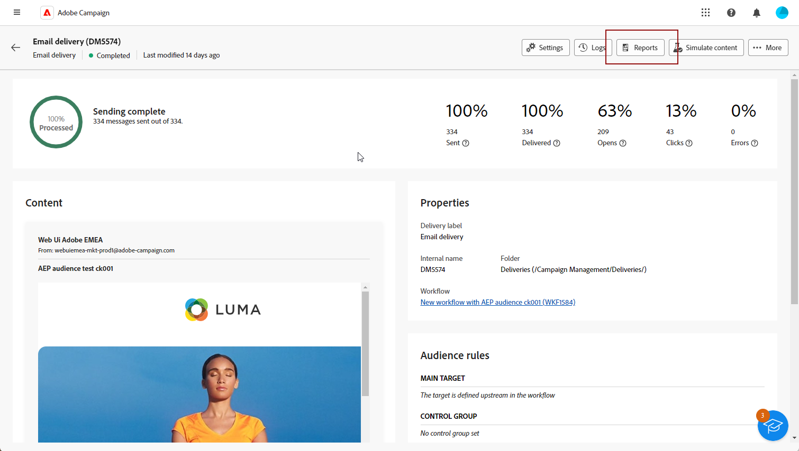
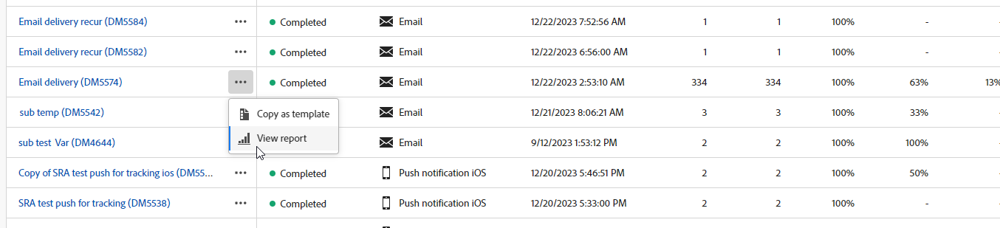
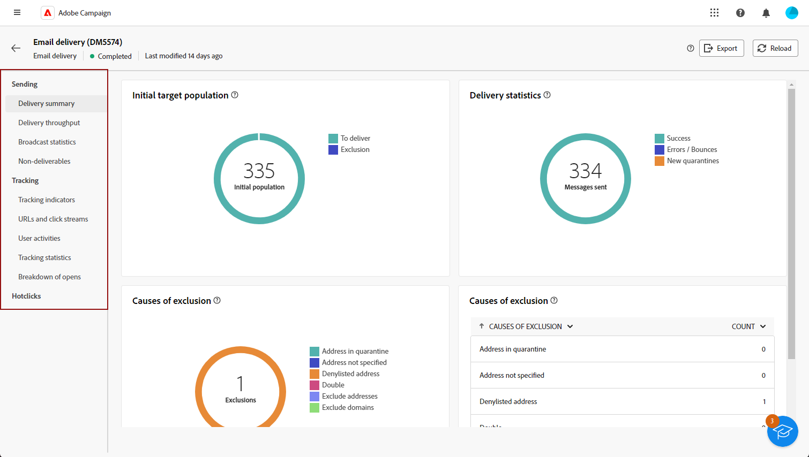
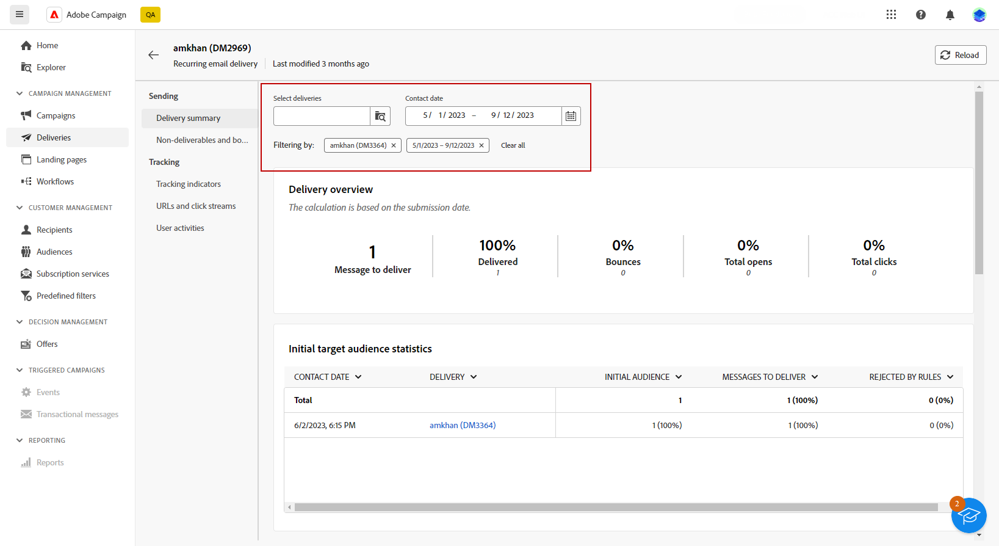
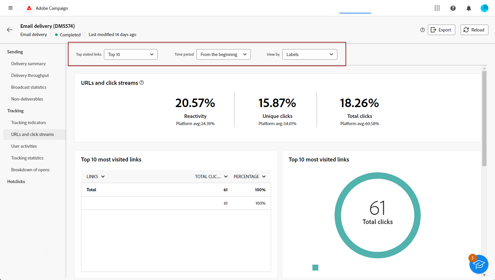

# Introdução a relatórios de entrega {#reports}

>[!CONTEXTUALHELP]
>id="acw_campaign_reporting_deliveries_selection"
>title="Relatórios agregados para entregas"
>abstract="Selecione pelo menos duas entregas para exibir um relatório de dados agregado."

Os **relatórios de entrega** fornecem insights e dados detalhados focados exclusivamente nas suas **entregas** em cada canal. Esses relatórios oferecem informações detalhadas sobre o desempenho, a eficácia e os resultados de seus deliveries individuais, fornecendo uma visão geral abrangente.

A lista completa de relatórios e métricas associadas para cada canal está disponível nas seguintes páginas:

* [Relatórios de entrega de email](email-report.md)
* [Relatórios de entrega por SMS](sms-report.md)
* [Relatórios de entrega por push](push-report.md)
* [Relatórios de delivery de correspondência direta](direct-mail.md)

## Gerencie seu painel de relatório {#manage-reports}

O Adobe Campaign oferece vários tipos de relatórios, acessíveis para cada entrega. Esses relatórios medem e visualizam o impacto e o desempenho de suas mensagens em um painel integrado.

Para exibir e gerenciar relatórios, siga estas etapas:

1. Para gerar um relatório para uma entrega específica, navegue até o menu **[!UICONTROL Entregas]** e selecione a entrega sobre a qual deseja criar o relatório.

1. No painel de **[!UICONTROL Entrega]**, clique em **[!UICONTROL Relatórios]**.

   {zoomable="yes"}

   Como alternativa, use o botão de três pontos **Mais ações** ao lado do nome da entrega na lista de entregas e selecione **[!UICONTROL Exibir relatório]**.

   {zoomable="yes"}

1. No menu esquerdo, selecione um relatório na lista.

   {zoomable="yes"}

1. Se a entrega for recorrente, selecione uma entrega específica a ser incluída no relatório clicando em **[!UICONTROL Selecionar entregas]**.

   Você também pode aplicar um período de tempo ao seu relatório selecionando a **[!UICONTROL Data de contato]**.

   {zoomable="yes"}

1. Nas **[!UICONTROL URLs e fluxos de cliques]**, escolha os **[!UICONTROL Links Mais Visitados]** ou o **[!UICONTROL Período]**.

   As opções **[!UICONTROL Exibir por]** permitem filtrar URLs, Rótulos ou Categorias.

   {zoomable="yes"}

>[!CONTEXTUALHELP]
>id="acw_delivery_reporting_line_deliveries_overview"
>title="Visão geral do delivery LINE"
>abstract="Exibir mensagens a serem entregues, mensagens entregues e erros de entrega para a entrega LINE."

>[!CONTEXTUALHELP]
>id="acw_delivery_reporting_line_targeted_population"
>title="População direcionada LINE"
>abstract="O gráfico e a tabela **Targeted population** exibem dados relativos ao público-alvo do LINE: mensagens a serem entregues e exclusões."

>[!CONTEXTUALHELP]
>id="acw_delivery_reporting_line_overall_stats"
>title="Estatísticas gerais do LINE"
>abstract="O relatório **Estatísticas gerais** apresenta dados para as mensagens LINE enviadas: êxito e erros."

>[!CONTEXTUALHELP]
>id="acw_delivery_reporting_line_exclusions"
>title="Exclusões LINE"
>abstract="O gráfico e a tabela **Exclusões** exibem os motivos que impediram os perfis excluídos de receber a mensagem LINE."

>[!CONTEXTUALHELP]
>id="acw_delivery_reporting_throughput_line"
>title="Taxa de transferência de entrega LINE"
>abstract="O relatório **Taxa de transferência de entrega** apresenta a velocidade de entrega de suas mensagens LINE em um período especificado."
